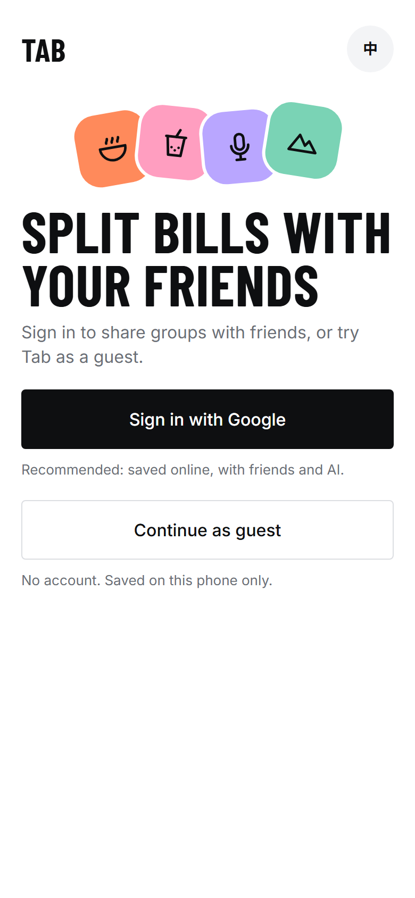
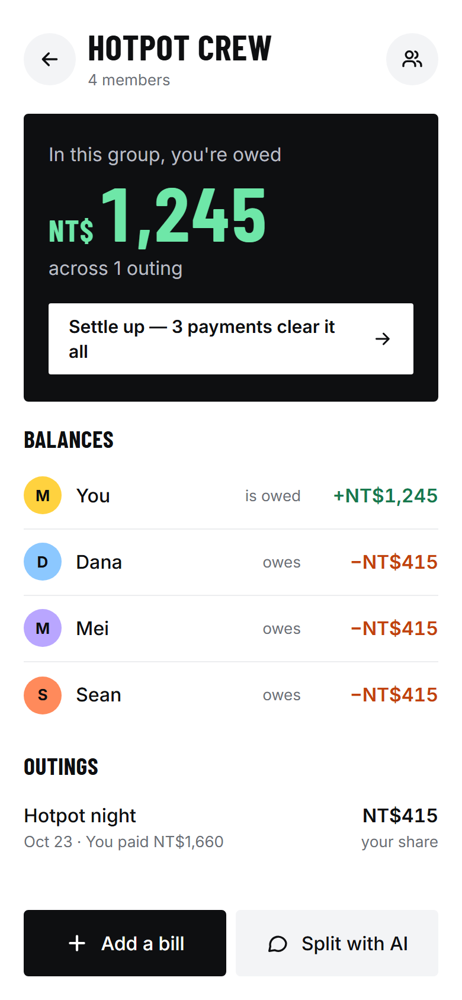
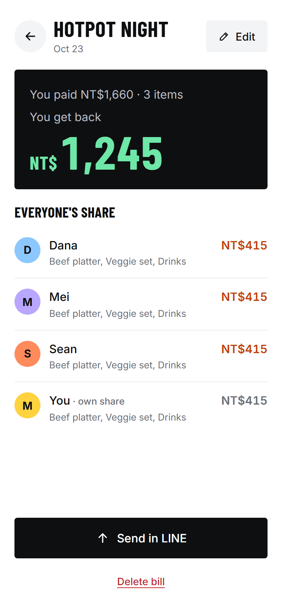
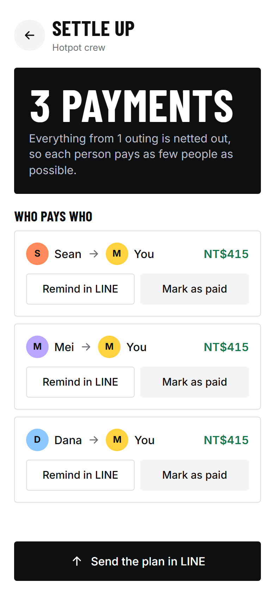

# Tab

A phone-first bill splitter for friends who go out together in Taiwan. Add what everyone had, and Tab keeps a running balance for each group and works out the fewest payments to settle up. Amounts are in New Taiwan Dollars, and the app speaks English and Traditional Chinese.

**Open it:** https://kyle4045.github.io/tab/

<p>
  
  
  
  
</p>

## What it does

- **Bills:** who came, who paid, who shared each item, plus optional service charge and tax. Uneven splits work item by item.
- **Settle up:** balances across all of a group's outings, netted into as few payments as possible. Mark payments as paid as they happen.
- **Friends and groups:** add friends with a personal link or QR code. Invite friends into a group (they accept), or send a group invite link to someone new.
- **Chat:** a chat for each group and private messages between friends. Bills, reminders and settle-up plans can be shared as cards.
- **LINE:** one tap sends a bill, a reminder or the settle-up plan to a LINE chat. Links opened inside LINE switch to the phone's browser, where Google sign-in works.
- **AI:** scan a receipt photo to fill in the items, or describe the night in plain words and let "Split with AI" build the bill.
- **Guest mode:** try it without an account. A guest's groups and bills stay on that phone only; friends, chat and AI need a sign-in.
- **Home-screen app:** "Add to Home Screen" gives Tab its own icon and opens it full-screen.

## How it's built

- **Static site:** plain HTML, CSS and JavaScript, no build step, served by GitHub Pages from `main`. Screens use [Preact](https://preactjs.com/) and [htm](https://github.com/developit/htm) from a CDN.
- **Firebase:** Google sign-in, and Firestore for the data. `firestore.rules` makes sure people only see their own groups, friends and messages. Tab is invite-only: an account gets in through a friend link or a group invite.
- **AI proxy:** a small Google Apps Script web app (`proxy/`) that checks the caller's sign-in, rate-limits each person, and calls Gemini on Vertex AI. Receipt photos are shrunk in the browser before they are sent.

| File | What it holds |
|---|---|
| `index.html` | The page and the scripts it loads |
| `app.js` | Every screen |
| `store.js` | Everything that talks to Firebase and the AI proxy; guest data |
| `calc.js` | The money maths: shares, balances, settle-up |
| `i18n.js` | All text, in English and Traditional Chinese |
| `app.css` | The look |
| `config.js` | The public Firebase web config and the proxy's address |
| `firestore.rules`, `firestore.indexes.json` | Database security rules and the one search index they need |
| `proxy/` | The Apps Script AI proxy |
| `tests/` | Rules tests and phone-sized browser tests |

## Run it locally

You need Node.js, Java (for the Firebase emulators) and the Firebase CLI (`npm install -g firebase-tools`).

1. Start the Firebase emulators: `dev/emulators.ps1`
2. Serve the folder: `dev/serve.ps1`
3. Open http://localhost:8765/?emu

`?emu` points the page at the emulators. Without it, a local page uses the real database.

## Tests

Install the test tools once:

```bash
npm --prefix tests install
```

Then, with the emulators and the page server running:

```bash
npm --prefix tests test
```

```bash
node tests/e2e.mjs
```

```bash
node tests/guest.mjs
```

The first runs the security rules tests. `e2e.mjs` drives the whole app with four accounts on a phone-sized screen, and `guest.mjs` does the same for guest mode. `node tests/live.mjs` checks the published site, signed out and as a guest.

## Secrets

This repo is public, and nothing in it is secret. The Firebase web config in `config.js` is designed to be public: access is controlled by sign-in and the database rules. The Google Cloud project used by the AI proxy lives in `proxy/Secrets.gs`, which is gitignored; `proxy/Secrets.example.gs` shows its shape.
